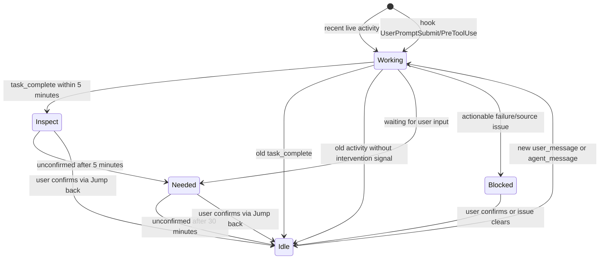

# Status Flow Rules

This document is the working specification for session status classification and state transitions.
The status model is the core product behavior of Agent Session Inbox. Treat this file as the source of truth while we refine the design.

## Product Goal

Agent Session Inbox is not a dashboard. It should keep multiple agent sessions visible only when that helps the user decide where to intervene.

The status model should answer one question:

> Do I need to do anything with this agent session right now?

## State Layers

The implementation currently has three layers. Keeping them separate prevents most confusion.

| Layer | Examples | Purpose |
| --- | --- | --- |
| Source observation | `Running`, `Idle`, `Completed`, `CompletedStale`, `WaitingForInput`, `Failed`, `InsufficientEvidence` | Raw or inferred evidence from SQLite, JSONL, and process checks. |
| Internal row state | `running`, `idle`, `needsAttention`, `dismissable`, `unknown` | Normalized state used by commands and storage. |
| UI display key | `working`, `idle`, `needed`, `inspect`, `blocked` | Stable key used for sorting and colors. Labels can be localized, for example `needed` displays as `follow-up` or `待跟进`. |

## Event Sources

The status model should use multiple event sources with different responsibilities.

| Source | Role | Strength | Weakness |
| --- | --- | --- | --- |
| Codex hooks | Real-time lifecycle signal | Best source for "something is happening now." | Only works for sessions that have hooks installed and trusted. Does not replay old history. |
| JSONL | Persistent event evidence | Best source for durable task events such as `task_complete` and conversation messages. | Requires parsing and can lag behind runtime. |
| SQLite thread DB | Persistent session index | Best source for thread discovery, workspace, title, archive status, and updated time. | Thread metadata alone is not enough to prove semantic status. |
| Live process scan | Runtime fallback | Can prove a CLI session is still running. | Process matching is approximate and platform-specific. |

The intended model is:

- Hooks provide real-time status edges.
- JSONL provides durable status facts.
- SQLite provides discovery and metadata.
- Process checks fill gaps when hook data is missing.

## Current Display Statuses

| Display status | Marker | Meaning | Should user act? |
| --- | --- | --- | --- |
| `working` | `○ working` | The agent is actively executing work now. | No. Keep visible as quiet context. |
| `idle` | `○ idle` | No active work is happening and no user action is required. | No. This is quiet baseline state. |
| `needed` | `● follow-up` | The session was opened recently and may still need a short follow-up before it settles. | Yes. |
| `inspect` | `● inspect` | The agent just produced a result that should be checked while context is fresh. | Yes. |
| `blocked` | `● blocked` | The agent cannot continue because of missing evidence, unavailable source, or an actionable failure signal. | Yes. |

### Display Name Rationale

`inspect` replaces `review` because the expected action is "check what happened", not necessarily approve or code-review the result.
`review` carried an acceptance/assessment implication that was broader than this product needs.

`follow-up` is the display label for the internal `needed` state.
It means "keep this session in short-term attention after it was opened" without implying the agent has a response to read, that the only possible action is text input, or that the user must personally complete the underlying task.

Chinese labels, if the UI becomes localized:

| English | Recommended Chinese | Rationale |
| --- | --- | --- |
| `blocked` | `受阻` | Short and clearly means the agent cannot continue. |
| `inspect` | `待检查` | Matches the action: open and inspect the result. |
| `follow-up` | `待跟进` | Matches the post-read window: the user may need to continue, confirm, or take over soon without implying an urgent blocker. |
| `working` | `进行中` | Clear active-work state. |
| `idle` | `空闲` | Quiet no-action state. |

The UI language is a display configuration, not a state-model change.
Internal states and persisted records should keep stable English identifiers; only user-facing labels and counters switch between English and Chinese.

## Current Source Rules

These are the rules implemented today.

### JSONL Event Rules

| JSONL evidence | Source observation |
| --- | --- |
| Last relevant event is `task_complete` and the signal is unread | `CompletedImmediate` |
| Last relevant event after `task_complete` is `user_message` or `agent_message`, and it is recent | `Running` |
| Recent activity but no terminal event | `Running` |
| Old activity with no terminal event | `InsufficientEvidence` |

Completion attention is read-driven, not completion-age-driven:

- `inspect`: completed result has not been opened/read yet.
- `needed`: completed result was opened/read within the last 30 minutes.
- `idle`: completed result was opened/read more than 30 minutes ago.

To avoid flooding the panel with historical completions, unread-completion tracking has a migration baseline:
completion events before `2026-06-05T08:00:00Z` are treated as old history and stay quiet unless newer source evidence appears.

Generic non-terminal activity is still considered recent for 2 hours.

### SQLite Thread Rules

| SQLite/thread evidence | Source observation |
| --- | --- |
| JSONL says `CompletedImmediate`, `Completed`, `Failed`, or `WaitingForInput` | Use JSONL terminal/input state. |
| JSONL says unread `task_complete` | Keep as `CompletedImmediate` until read. |
| Thread is archived without explicit unread completion evidence | Apply completion-age fallback, usually `CompletedStale` for old archived threads. |
| Desktop thread has recent activity | `Running` |
| Desktop thread is old and unarchived | `Idle` |
| CLI thread has no recent JSONL signal | `InsufficientEvidence`, unless a live CLI process is found. |

### Live CLI Process Rule

If a CLI row is `unknown` and a live Codex process is found for the same workspace, the row is promoted to `running`.

## Codex Hook Rules

Codex supports lifecycle hooks such as `SessionStart`, `UserPromptSubmit`, `PreToolUse`, `PostToolUse`, and `Stop`.
These hooks should become the preferred source for live status transitions once this app owns a small hook writer.

### Hook Event Semantics

| Hook event | Proposed source observation | Notes |
| --- | --- | --- |
| `SessionStart` with `startup` or `resume` | `Running` | A session has become active. |
| `UserPromptSubmit` | `Running` | A new user request starts active work. |
| `PreToolUse` | `Running` | The agent is about to execute a tool. |
| `PostToolUse` | `Running` | The agent just executed a tool; update last activity. |
| `Stop` | pending terminal check | A turn ended. Do not classify as `Completed` by itself. |

`Stop` is intentionally not a final state. It can mean success, waiting for input, interruption, tool failure, or a normal turn boundary.
After `Stop`, the app should consult JSONL and any hook payload to decide whether the row becomes `inspect`, `needed`, `blocked`, or `idle`.

### Hook Storage

The hook writer should append compact events to an app-owned local store.
It should not require the UI process to be running.

Candidate storage:

- SQLite table in the app data directory.
- JSONL file in the app data directory.

Minimum event fields:

| Field | Purpose |
| --- | --- |
| `sessionId` | Join hook events to Codex sessions. |
| `workspacePath` | Fallback join key and display metadata. |
| `eventType` | Hook event such as `UserPromptSubmit` or `Stop`. |
| `timestamp` | Ordering and freshness. |
| `source` | `codex-hook`. |
| `payloadVersion` | Future migration safety. |

### Hook Trust and Scope

Codex hooks must be installed in a trusted hook source and reviewed/trusted by Codex before running.
Project-local hooks only load for trusted project `.codex/` layers.
User-level hooks under `~/.codex/hooks.json` can cover all sessions on this machine.

For this app, user-level hooks are likely the right default because the status panel watches sessions across many repos.

## Current Classification Rules

| Source observation | Internal row state | Confidence | Status reason |
| --- | --- | --- | --- |
| `Running` | `running` | `exact` | `running signal observed` |
| `Idle` | `idle` | `inferred` | `no recent activity observed; idle until the next source signal` |
| `WaitingForInput` | `needsAttention` | `exact` | `waiting for user input` |
| `CompletedImmediate` | `inspect` | `exact` | `completed task ready to inspect; open it to mark read` |
| `Completed` | `needsAttention` | `exact` | `completed task still needs your attention` |
| `CompletedStale` | `idle` | `inferred` | `completed task is no longer recent; idle until the next source signal` |
| `Failed` | `inspect` | `exact` | `failed task can be manually reviewed and cleared` |
| `InsufficientEvidence` | `unknown` | `unknown` | `missing source evidence for status classification` |

## Current UI Mapping

| Internal row state | UI display status |
| --- | --- |
| `running` | `working` |
| `idle` | `idle` |
| `needsAttention` | `needed` |
| `inspect` | `inspect` |
| legacy `dismissable` | `inspect` |
| `unknown` with actionable reason | `blocked` |
| `unknown` without actionable reason | hidden from watchlist |

Actionable unknown reasons currently match words such as `failed`, `unavailable`, `blocked`, `needs attention`, or `approval`.

## Current User Actions

| User action | Current transition |
| --- | --- |
| Click Jump back on an `inspect` row | Mark the current signal as read, then show it as `follow-up` for 30 minutes. |
| Read window exceeds 30 minutes | Show the row as `idle` until newer source evidence arrives. |
| Click Jump back on `working` or `idle` | No state transition. |
| Dismiss an `inspect` or `unknown` row | Hide it until the source changes to `running` or `needsAttention`. |
| Dismiss a `working` or `needed` row | It is restored immediately on next list because active/intervention rows should not stay hidden. |

Read acknowledgement is keyed by `sessionId + lastActivityAt` and stores `acknowledgedAt`.
If the same session gets newer activity, the read acknowledgement no longer applies.

## Known Problems

These are the areas that currently feel wrong or need product decisions.

1. Completion attention is read-bounded.
   A completed result stays `inspect` until opened/read, then shows `follow-up` for 30 minutes, then `idle`.

2. `inspect` still combines successful completion and failure/manual-clear cases.
   These may need separate reasons later, but the shared user action is still "open and inspect."

3. `idle` has two meanings.
   It can mean "old inactive session" or "user confirmed this session." These are both quiet, but they may need different reasons or sorting.

4. Time windows are hard-coded.
   `recent = 2 hours` is a technical default, not yet a product decision.

5. The panel still behaves partly like a list of sessions.
   The product goal is an intervention watchlist. Old quiet rows should probably be hidden or collapsed more aggressively.

6. Hooks are not integrated yet.
   Without hooks, "working" is inferred from SQLite/JSONL recency instead of a real lifecycle signal.

## Open Product Decisions

We should decide these before more code changes.

1. When should `task_complete` become visible?
   Current decision: unread completed results stay `inspect`; reading them starts a 30-minute `follow-up` window, then they become `idle`.

2. What does `inspect` mean?
   It means a result was produced and should be checked while context is fresh.

3. What should be visible by default?
   Proposed priority:
   - `blocked`
   - `inspect`
   - `needed`
   - current `working`
   - recent `idle`

4. Should quiet states be visible at all?
   Current behavior keeps `working` and `idle` visible. A stricter intervention watchlist may show `working` only for current live work and hide most `idle`.

5. What is the retention rule for completed sessions?
   Current decision: completions older than 30 minutes become `idle`.

6. Where should the hook writer live?
   Options:
   - User-level `~/.codex/hooks.json`, covering all local Codex sessions.
   - Project-level `.codex/hooks.json`, covering only this repo.
   - Plugin-bundled hook, installed/enabled with the app.

## Proposed Direction

This is not final. It is a candidate rule set for the next implementation pass.

Candidate principles:

- `working` means active execution, not merely "thread exists."
- Hook events should be the strongest proof of `working`.
- `idle` means no action required.
- `inspect` should be scarce. It should represent something the user is likely to care about now.
- Old completions should automatically become `idle`.
- `needed` and `blocked` are the strongest intervention states.
- Old historical sessions should not crowd the panel.

## Code Touchpoints

| Concern | File |
| --- | --- |
| Source and row type definitions | `src-tauri/src/domain/session.rs` |
| Observation-to-row classification | `src-tauri/src/domain/classification.rs` |
| SQLite/JSONL source extraction | `src-tauri/src/codex_source.rs` |
| Jump acknowledgement and dismiss behavior | `src-tauri/src/inbox_store.rs` |
| Browser/dev source mirror | `scripts/codexSessionsDevSource.mjs` |
| UI status model and sorting | `src/features/statusPanel/statusPanel.ts` |
| UI rendering and actions | `src/features/statusPanel/StatusPanelView.tsx` |
